# Media Connector for Lytho

:fontawesome-regular-square: Built-in  
:fontawesome-regular-square: Built by CHILI publish  
:fontawesome-regular-square-check: Third Party

[See Connector Types](/GraFx-Studio/concepts/connectors/#types-of-connectors)

The Lytho connector lets you browse, search, and place images from your Lytho DAM directly in GraFx Studio. It is read-only: assets are never uploaded to or changed in Lytho.

## Solution vendor website

See [Lytho's website](https://www.lytho.com/)

## Installation

The installation is done by enabling the Lytho connector on the environment.

[See Installation Through Connector Hub](/GraFx-Studio/guides/connector-hub/)

Setting up the connector is a one-time task for an administrator. Template Designers and end users never enter the connector's credentials. With per-user sign-in, each user signs in once with their own Lytho login.

You need:

- A **Lytho account admin**, to get the connection values from Lytho.
- A **CHILI GraFx administrator**, to enter them in your environment.

Often this is the same person.

## Choose How Users Sign In

Before you start, decide which of the two setups you want. You can change it later.

| Setup | What users see | Sign-in |
|---|---|---|
| **Account-level access** | Every asset in your Lytho account | None. The connector always connects with the account's credentials. |
| **Per-user sign-in** | Only the assets their own Lytho user may see | Each user signs in to Lytho once in GraFx Studio |

Exporting and rendering output always uses the account's credentials, because no user is present at that point. In both setups, this lets templates that contain restricted assets still export.

## Lytho Configuration

In Lytho, go to **Settings → Advanced → GraFx connector**.

!!! info "Don't see the GraFx connector tab?"
    The tab is only shown to account admins, and the connector has to be enabled for your Lytho account. Contact Lytho Support if it is missing.

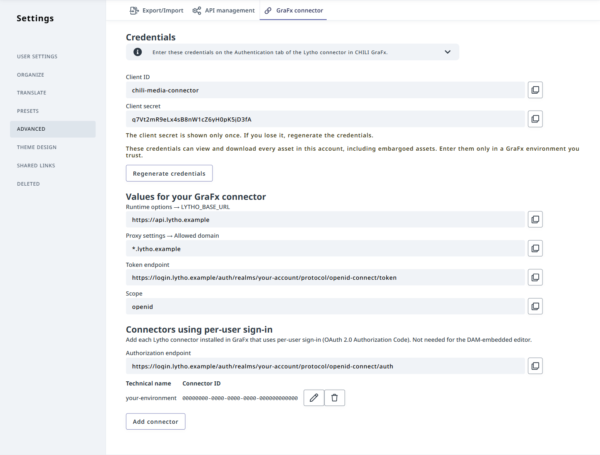{.screenshot-full}

### Generate the credentials

Click **Generate credentials**. Lytho shows:

- **Client ID**
- **Client secret**

!!! warning "The client secret is shown only once"
    Copy the client secret immediately and keep it somewhere safe. If you lose it, click **Regenerate credentials** to get a new one.

These credentials can view and download every asset in your Lytho account, including embargoed assets. Enter them only in a GraFx environment you trust.

You need one set of credentials per Lytho account. Use the same Client ID and Client secret in every GraFx environment you connect, for example both your sandbox and your production environment.

### Values for your GraFx connector

The **Values for your GraFx connector** section lists the other values you need:

- **Runtime options → LYTHO_BASE_URL**
- **Proxy settings → Allowed domain**
- **Token endpoint**
- **Scope**

Each value has a copy button. The labels tell you where each value goes in CHILI GraFx.

## CHILI GraFx Connector Configuration

From the overview of Environments, click on "Settings" on the right of the environment where you want to configure the Connector.

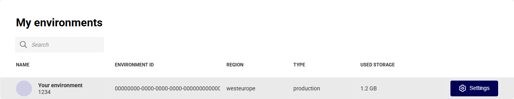{.screenshot-full}

Then click **Connectors** and open the installed Lytho Connector.

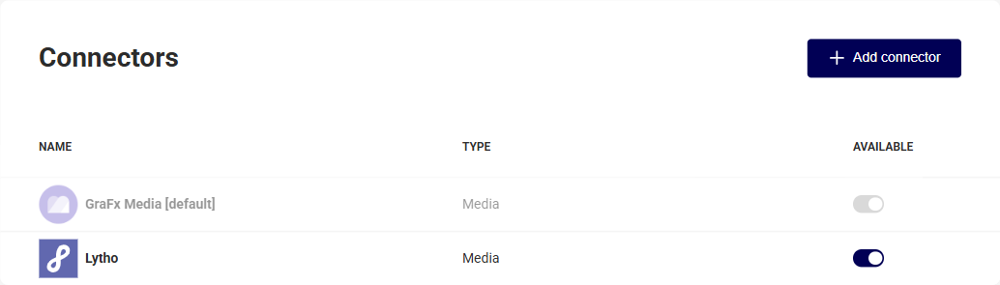{.screenshot-full}

### Configuration

On the **Configuration** tab:

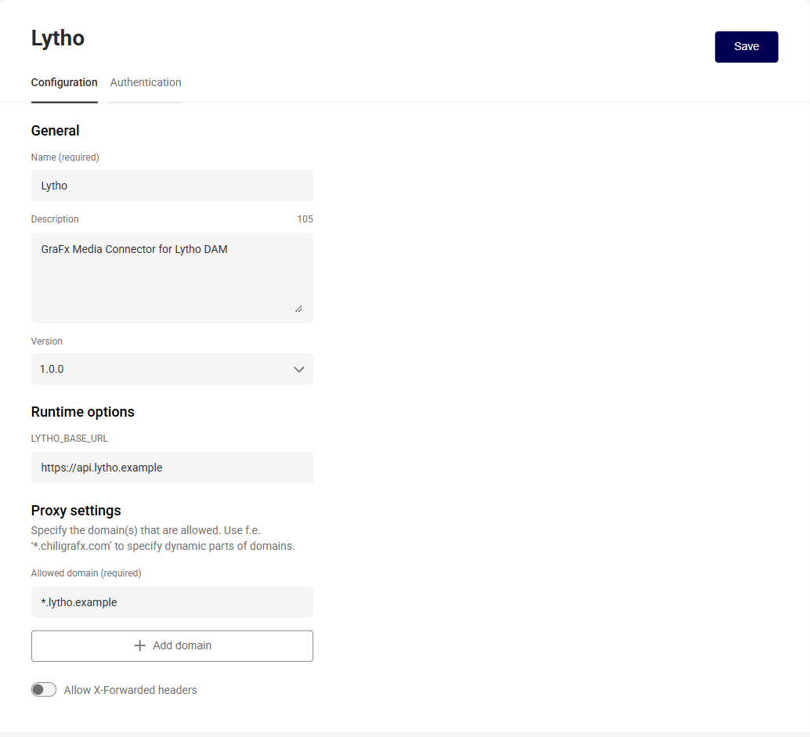{.screenshot-full}

**Runtime options**

- **LYTHO_BASE_URL**: paste the value of **Runtime options → LYTHO_BASE_URL** from Lytho.

**Proxy settings**

- **Allowed domain**: paste the value of **Proxy settings → Allowed domain** from Lytho.

Click **Save**.

### Authentication

On the **Authentication** tab, follow the steps for the setup you chose.

#### Account-level access

Leave **Enable separate server and browser authentication** off.

**Server and browser authentication:** OAuth 2.0 Client Credentials

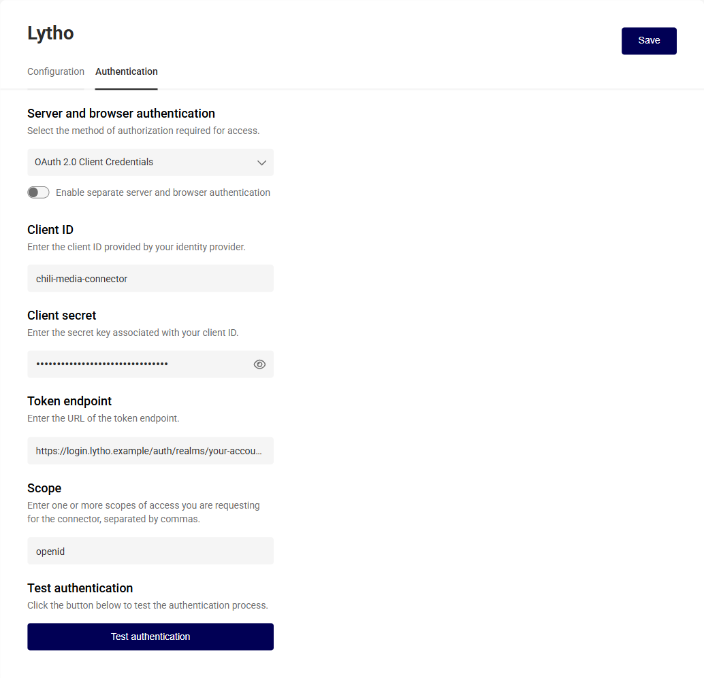{.screenshot-full}

- **Client ID**: the **Client ID** from Lytho
- **Client secret**: the **Client secret** from Lytho
- **Token endpoint**: the **Token endpoint** from Lytho
- **Scope**: the **Scope** from Lytho

Optionally, click **Test authentication** to check the values before you save.

Click **Save**.

#### Per-user sign-in

Turn on **Enable separate server and browser authentication**.

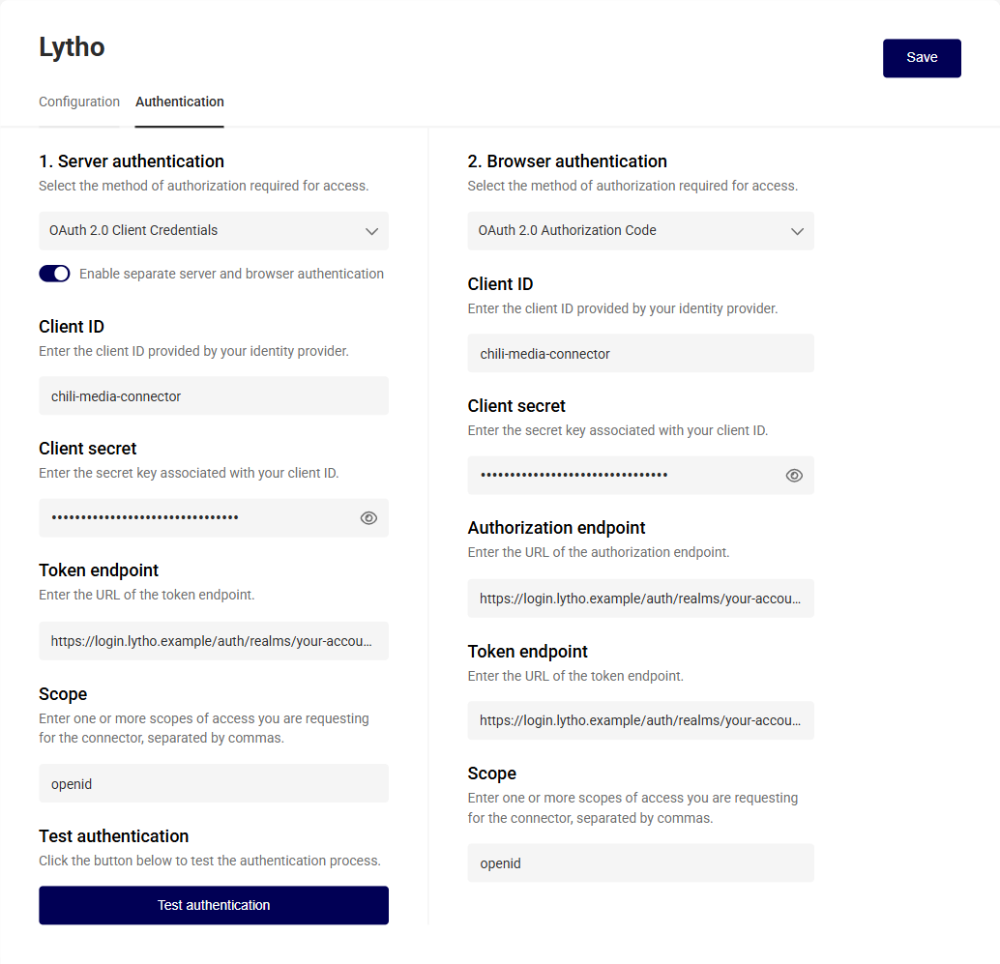{.screenshot-full}

**1. Server authentication:** OAuth 2.0 Client Credentials

- **Client ID**, **Client secret**, **Token endpoint**, and **Scope**: the values with the same names in Lytho

**2. Browser authentication:** OAuth 2.0 Authorization Code

- **Client ID**: the **Client ID** from Lytho
- **Client secret**: the **Client secret** from Lytho
- **Authorization endpoint**: the **Authorization endpoint** from Lytho. You find it under **Connectors using per-user sign-in**.
- **Token endpoint**: the **Token endpoint** from Lytho
- **Scope**: the **Scope** from Lytho

Optionally, click **Test authentication** to check the values before you save.

Click **Save**.

##### Register the connector in Lytho

Per-user sign-in only works after Lytho knows about this connector. Do this once for every GraFx environment in which you set up per-user sign-in.

1. In CHILI GraFx, find your environment's **Technical name** under **Settings → General**.

    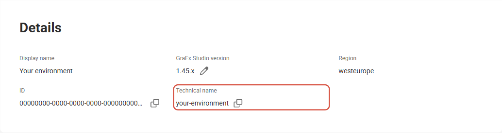{.screenshot-full}

2. Copy the address of the Lytho connector's page in CHILI GraFx (**Settings → Connectors →** your Lytho connector). You can also use just the connector ID at the end of that address.
3. In Lytho, go to **Settings → Advanced → GraFx connector → Connectors using per-user sign-in** and click **Add connector**.
4. Enter the **Technical name**, paste the address in **Connector URL or ID**, and click **Save**.

    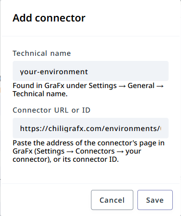{.screenshot}

The first time a user opens Lytho assets in GraFx Studio, they are asked to sign in with their Lytho login.

## Using Assets from Your Lytho DAM

### Place Assets in Your Template

- Select the Lytho Connector.

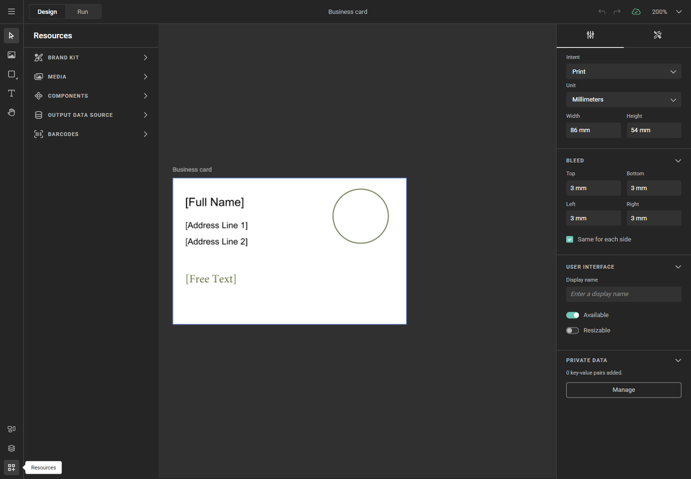{.screenshot-full}

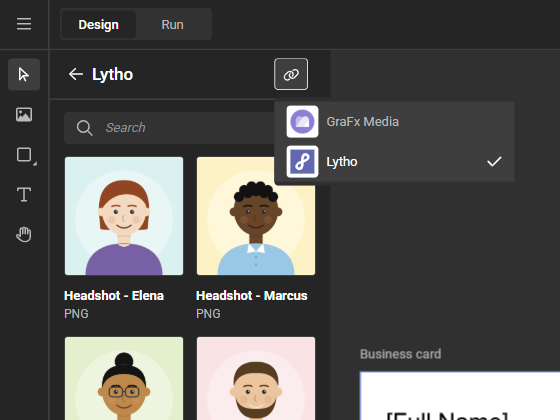{.screenshot-full}

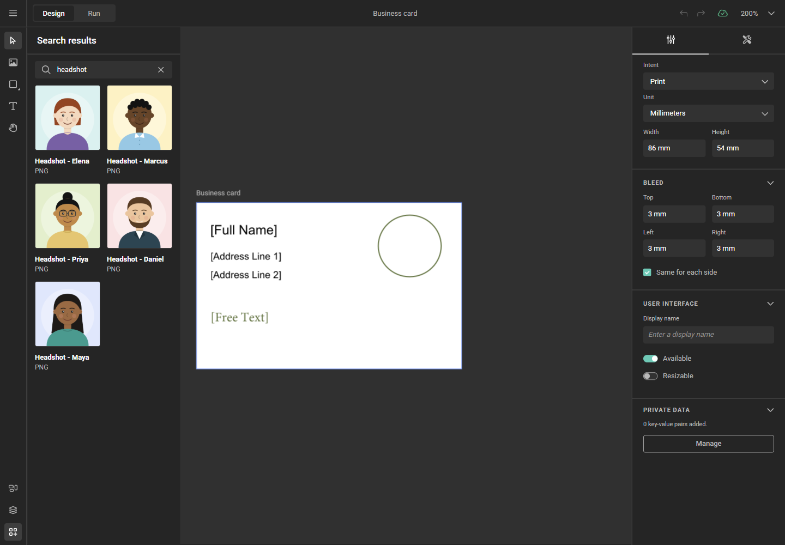{.screenshot-full}

### Image Variables

When using [image variables](/GraFx-Studio/guides/template-variables/image/), you see the same grid of Lytho assets when selecting an image.

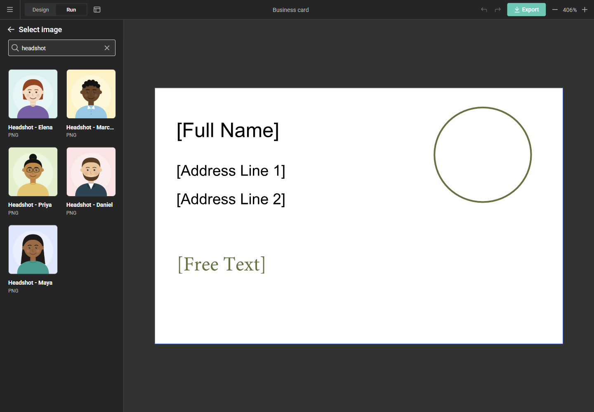{.screenshot-full}

### Metadata mapping

The connector makes each asset's file type, file name, and tags available as metadata.

See [Concept of metadata mapping](/GraFx-Studio/concepts/connectors-media/#concept-2-making-assets-available-and-exposing-metadata) for more details.

### Which assets are available

- **File types:** only assets that GraFx Studio can use are shown: EPS, JPG/JPEG, PDF, PNG, PSD, TIF/TIFF, and AI.
- **Visible start and end dates:** with per-user sign-in, assets outside their visible dates in Lytho are hidden, unless the user may see embargoed assets. This matches what the user sees in Lytho itself. With account-level access, these assets are shown.
- **Publish start and end dates:** assets outside their publish dates in Lytho are never offered, in either setup. An asset placed in a template is downloaded into the output and cannot be withdrawn later, so expired and not-yet-published assets are kept out.

These filters only affect browsing and searching. An asset that is already placed in a template keeps working after its publish end date.

!!! note "Placed assets after their visible end date"
    With per-user sign-in, if an asset already used in a template passes its visible end date, the template can no longer load that asset for users who may not see embargoed assets.

## Troubleshooting

| Problem | Solution |
|---|---|
| The **GraFx connector** tab is missing in Lytho | Only account admins see it, and the connector must be enabled for your Lytho account. Contact Lytho Support. |
| You lost the client secret | In Lytho, click **Regenerate credentials** and enter the new secret in every GraFx environment that uses the connector. |
| The connector stopped working in every environment at once | Someone regenerated the credentials in Lytho. Enter the new Client secret on the **Authentication** tab of the Lytho connector in each environment. |
| Users get an "Invalid parameter: redirect_uri" error when signing in | The connector is not registered in Lytho. See [Register the connector in Lytho](#register-the-connector-in-lytho). |
| A user sees fewer assets than expected after their Lytho permissions changed | GraFx keeps a user's sign-in for a while. The new permissions apply once it renews, which can take up to about two hours. |
| An asset you expect is not listed | Check its file type and its visible and publish dates in Lytho (see [Which assets are available](#which-assets-are-available)). |
